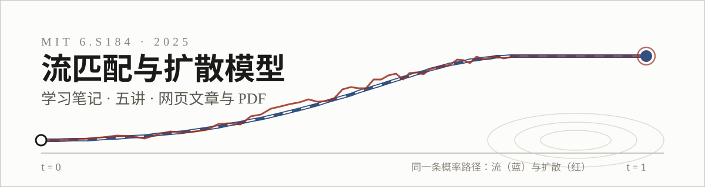

**MIT 6.S184 / 6.S183 · Flow Matching and Diffusion Models（2025）**
学习笔记 · 共五讲 · 每讲一篇网页文章 + 一份 PDF

*中文整理 · 交互图可操作 · 公式经完整校对*

---

## 目录

| # | 主题 | 内容 | 阅读 |
|:--:|---|---|:--:|
| 01 | **流与扩散模型** | 生成即采样：从数据分布出发，用流（ODE）与扩散（SDE）两种视角建立生成模型 | [网页](./lecture01_flow_diffusion_model.html) · [PDF](./lecture01_flow_diffusion_model.pdf) |
| 02 | **Flow Matching** | 条件概率路径与条件向量场，流匹配损失，以及它为什么能训练出边缘向量场 | [网页](./lecture02_flow_matching.html) · [PDF](./lecture02_flow_matching.pdf) |
| 03 | **Score Matching** | score function 视角：高斯路径下 score 与向量场互相换算，SDE 采样与 denoising score matching（DDPM） | [网页](./lecture03_score_matching.html) · [PDF](./lecture03_score_matching.pdf) |
| 04 | **Classifier-Free Guidance** | 引导生成：从分类器引导推出无分类器引导（CFG），训练时随机丢弃标签，推理时放大两个向量场之差 | [网页](./lecture04_CFG.html) · [PDF](./lecture04_CFG.pdf) |
| 05 | **架构、VAE 与案例研究** | 条件嵌入、DiT 与 U-Net，隐空间建模与 VAE，以及 Stable Diffusion 3 / Movie Gen 的零件清单 | [网页](./lecture05_architectures_vae.html) · [PDF](./lecture05_architectures_vae.pdf) |

## 怎么看

- **网页版（推荐）**：点目录里的链接，或下载后双击用浏览器打开。单文件、无需联网；网页里有**可操作的交互图**（拖动滑块、点击图面），PDF 里只有它们的初始状态。
- **PDF 版**：静态打印版，公式排版与网页一致，方便存档和批注。

## 说明

- 笔记为个人整理，原文对应课程讲义 *Flow Matching and Diffusion Models*（MIT, 2025）；文中讲义截图与算法截图的版权归课程作者所有，仅用于个人学习。

---

Flow Matching &amp; Diffusion Models · Notes 01–05 · 2026

